<p align="center">
  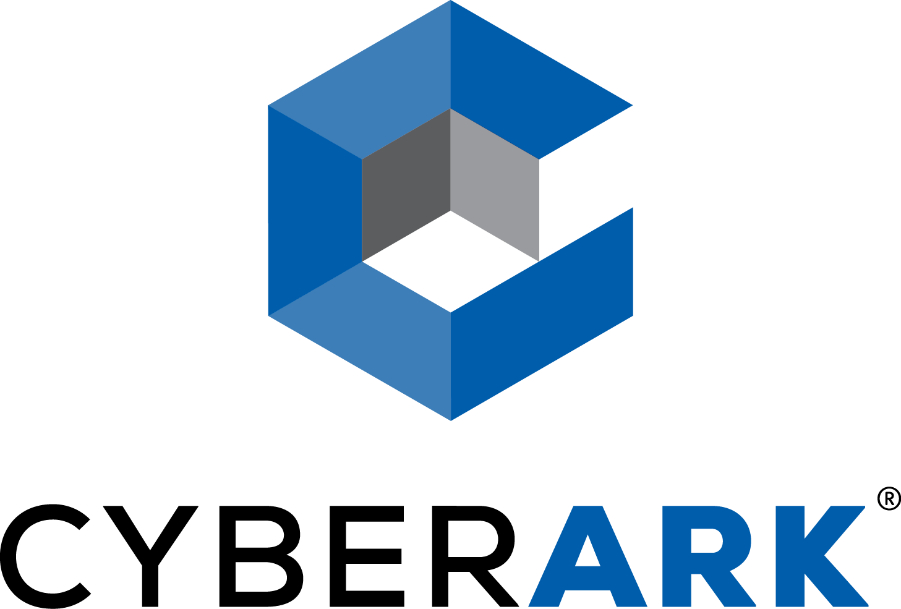
</p>

<h1>CyberArk PAM – Privileged Account Recovery and Lifecycle Management</h1>

In this lab, I used CyberArk PAM to detect and recover a privileged account with an incorrect password, then revoked its access and removed the account from our environment. I intentionally changed a Windows local administrator password outside of CyberArk, observed the failed CPM verification, and used an existing reconciliation account to restore access. Finally, I disabled the account, removed its administrator privileges, and deleted it from both CyberArk and Windows. This lab demonstrates password reconciliation and privileged account lifecycle management.

<h2>Environments and Technologies Used</h2>

- Microsoft Hyper-V (Virtual Machines)
- CyberArk Privileged Access Management (PAM)
- CyberArk Password Vault Web Access (PVWA)
- CyberArk Central Policy Manager (CPM)
- CyberArk Digital Vault
- Windows PowerShell

<h2>Operating Systems Used</h2>

- Windows Server 2019 

<h2>High-Level Steps</h2>

- Step 1. Create a Password Mismatch
- Step 2. Verify the Account and Observe the Failure
- Step 3. Verify the Existing Reconciliation Account
- Step 4. Link the Reconciliation Account
- Step 5. Reconcile the Password
- Step 6. Disable the Account and Remove Administrator Privileges
- Step 7. Delete the Managed Account from CyberArk
- Step 8. Delete the Local Windows Account

> [!IMPORTANT]
> Each step includes instructions and observations followed by a corresponding screenshot. The **See screenshots** sections are open by default but can be collapsed.

<h2>Actions and Observations</h2>

<b>1. CREATE A PASSWORD MISMATCH</b>

On the target VM, `TARGET01` (`10.10.10.50`), open PowerShell as Administrator. Change the password for the existing local administrator account, `PAMLabAdmin`, directly in Windows without updating the password stored in CyberArk.

```powershell
$Password = Read-Host "Enter new password for PAMLabAdmin" -AsSecureString
Set-LocalUser -Name "PAMLabAdmin" -Password $Password
```

The Windows account now has a different password than the one CyberArk has stored. We will use CPM Verify to detect this mismatch.

<details open><summary>See screenshots</summary>

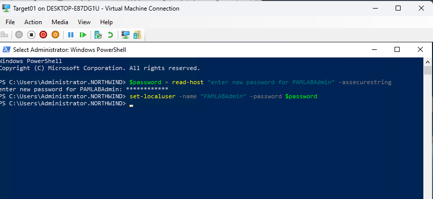

</details>

<b>2. VERIFY THE ACCOUNT AND OBSERVE THE FAILURE</b>

Back in CyberArk PVWA, navigate to **Accounts** and open the `PAMLabAdmin` account. Select **Verify** and review the result on the account's Overview page.

Notice the **CPM failed to verify this password** message. 


<details open><summary>See screenshots</summary>

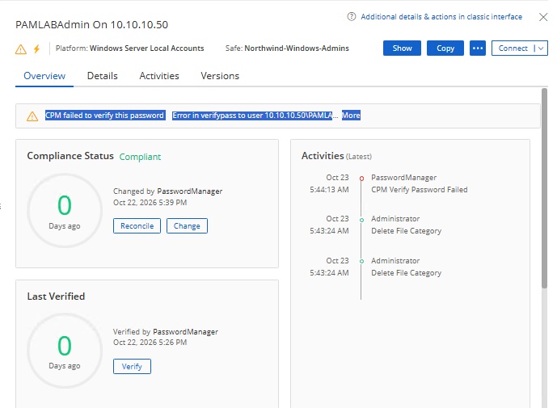

</details>

```text
Reason: The user name or password is incorrect. (winRc=1326)
```

<b>3. VERIFY THE EXISTING RECONCILIATION ACCOUNT</b>

For password reconciliation, we'll use an existing local administrator account named `PAMReconcile`, which has already been onboarded into CyberArk. On `TARGET01`, open PowerShell and run the following commands to verify the account is enabled and belongs to the local Administrators group.

On `TARGET01`, open PowerShell as Administrator and confirm that `PAMReconcile` is enabled and still belongs to the local **Administrators** group.

```powershell
Get-LocalUser -Name "PAMReconcile"
Get-LocalGroupMember -Group "Administrators"
```

Observe that `PAMReconcile` is enabled (`True`) and listed as `TARGET01\PAMReconcile` in the Administrators group. This account has the permissions needed for our Windows password reconciliation task.

<details open><summary>See screenshots</summary>

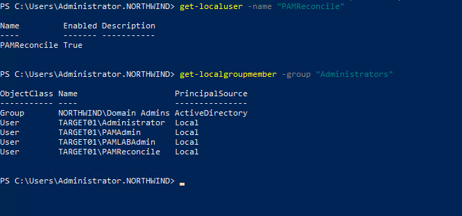

</details>

<b>4. LINK THE RECONCILIATION ACCOUNT</b>

Return to PVWA and open the **Details** tab for `PAMLabAdmin`. Under **Linked Accounts**, locate **Reconcile Account** and select our existing `PAMReconcile` account on `10.10.10.50`. Save the change.

Observe that `PAMReconcile` is now displayed as the linked Reconcile Account. CyberArk can use this separate privileged account to reset the target account password even though the current `PAMLabAdmin` password is no longer valid.

<details open><summary>See screenshots</summary>

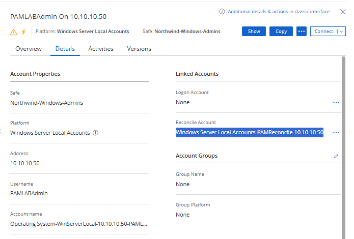

</details>

<b>5. RECONCILE THE PASSWORD</b>

On the `PAMLabAdmin` account page, select **Reconcile** and confirm the request. Allow CPM to process the task, then review the **Overview** and **Activities** tabs.

Observe **Reconciled by PasswordManager** and **Compliance Status: Compliant** on the Overview page. The Activities tab also records the **CPM Reconcile Password** task. The Overview page shows a subsequent verification by PasswordManager.

**Reconcile** uses the linked reconciliation account to reset the Windows password and update the managed credential in CyberArk. Our privileged account is now synchronized again.

<details open><summary>See screenshots</summary>

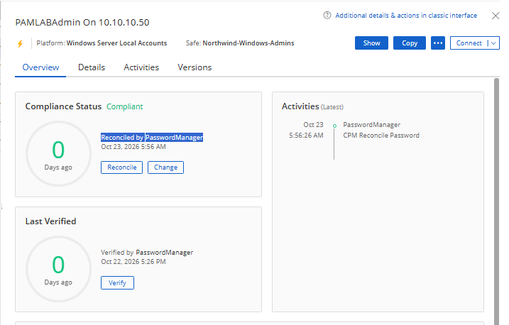

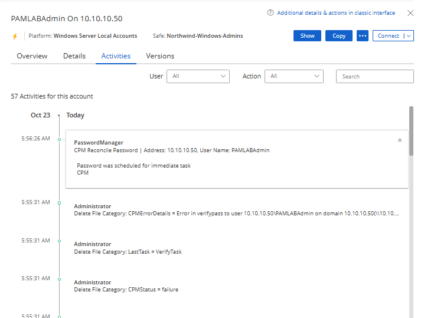

</details>

<b>6. DISABLE THE ACCOUNT AND REMOVE ADMINISTRATOR PRIVILEGES</b>

Now that we have demonstrated password recovery, we will begin decommissioning `PAMLabAdmin`. On `TARGET01`, open PowerShell as Administrator and disable the local account. Then remove it from the local Administrators group.

```powershell
Disable-LocalUser -Name "PAMLabAdmin"
Remove-LocalGroupMember -Group "Administrators" -Member "PAMLabAdmin"
```

Verify both changes:

```powershell
Get-LocalUser -Name "PAMLabAdmin"
Get-LocalGroupMember -Group "Administrators"
```

Observe that `PAMLabAdmin` displays **Enabled: False** and no longer appears in the Administrators group. The account still exists on Windows, but we have disabled it and removed its local administrator group membership.

<details open><summary>See screenshots</summary>

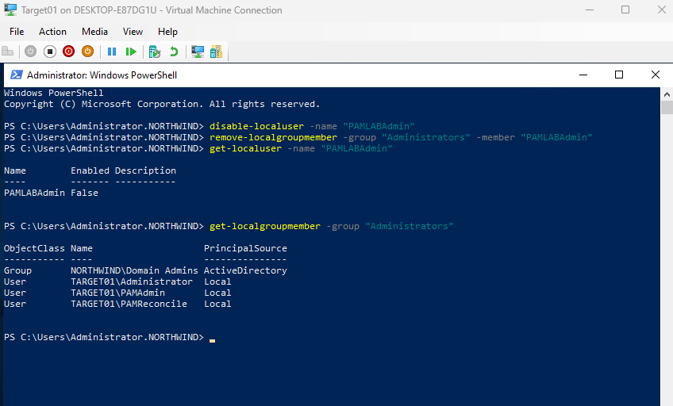

</details>

> [!NOTE]
> We disable the account and remove its administrative privileges first to revoke access before proceeding with account deletion. This is an important step in privileged access deprovisioning.

<b>7. DELETE THE MANAGED ACCOUNT FROM CYBERARK</b>

Return to **PVWA → Accounts** and locate `PAMLabAdmin`. Open the account's options, select **Delete**, and confirm the deletion.

Refresh the Accounts list and observe that `PAMLabAdmin` is no longer present. Our existing `PAMReconcile` account remains in the `Northwind-Windows-Admins` Safe.

Deleting a managed account from CyberArk removes its Vault account object; it does **not** automatically delete the local Windows user on `TARGET01`. We will remove that separately in the final step.

<details open><summary>See screenshots</summary>

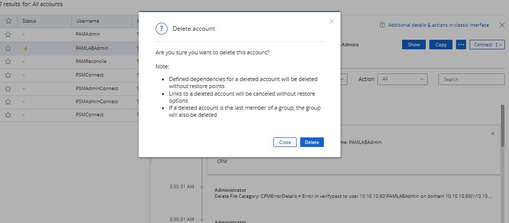

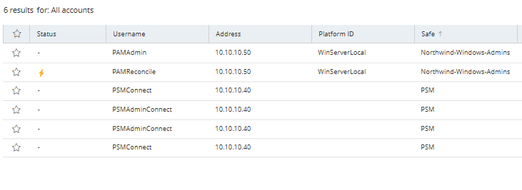

</details>

<b>8. DELETE THE LOCAL WINDOWS ACCOUNT</b>

Back on `TARGET01`, open PowerShell as Administrator and delete the disabled `PAMLabAdmin` account. Then attempt to retrieve the account again to confirm its removal.

```powershell
Remove-LocalUser -Name "PAMLabAdmin"
Get-LocalUser -Name "PAMLabAdmin"
```

Observe the **User PAMLabAdmin was not found** error from `Get-LocalUser`. This is expected because the local Windows account has been deleted.

<details open><summary>See screenshots</summary>

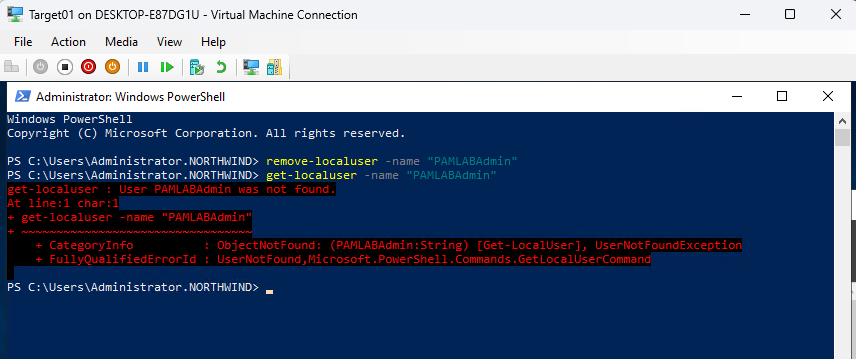

</details>
<br>

This lab demonstrates **Privileged Account Lifecycle Management**, a key component of Identity and Access Management (IAM). We intentionally created a password mismatch, detected it through CPM verification, and restored access using password reconciliation. We then followed the **deprovisioning process** by disabling the account, removing its administrative privileges, deleting its CyberArk account record, and finally removing the local Windows account. This demonstrates how CyberArk supports privileged credential recovery while maintaining control over the privileged account lifecycle.
